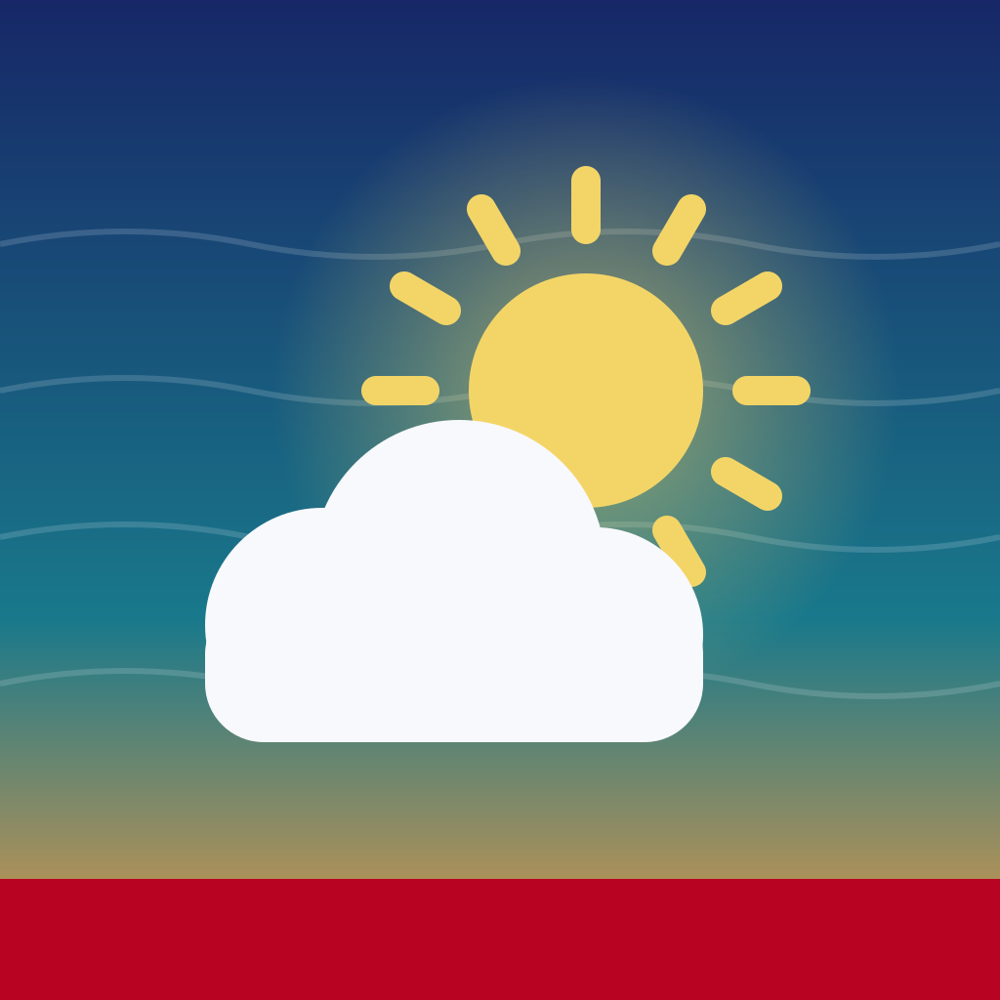

<p align="center">
  
</p>

<h1 align="center">ALMANAC</h1>
<p align="center"><b>Your body's weather report.</b><br/>A local-first, AI-powered health companion for Android (Flutter). No account. No backend. Your own Gemini key.</p>

---

Almanac reads your **Health Connect** data (Fitbit / Google Health sleep, HRV, resting heart rate, SpO2, respiration, steps, plus Cravin' meals and caffeine) and turns it into a sky: the sun's height is your readiness, clouds are short sleep and late dinners. Then it explains what the numbers mean in plain language, surfaces patterns, and suggests 7-day experiments you can actually run.

## Features

- **Today**: readiness sky with an AI headline, the forecaster's note, a live **Right now** card that follows your day, and last night at a glance with a one-line read per metric.
- **Discover**: pattern cards computed on-device (late dinner vs deep sleep, weekend jet lag, caffeine cutoff, post-lunch walk vs steps), Gemini's discoveries, and **Find new** for fresh patterns on demand.
- **Ask**: chat with your data. Gemini answers stream in live with your aggregates as context; a local brain answers when no key is set or you're offline.
- **Almanac**: every metric with a chart, your personal normal, an AI one-liner, and an auto-written "what yours say" explainer.
- **Experiments**: kitchen (dinner by 8:30), walk (10 min after lunch), chai (last chai by 3), weekend (same alarm). Daily check-ins, an AI coach that follows the week, before/after result.
- **Me**: sync health (freshness per category, which app is used, missing permissions, full resync), **Data check**, AI key, sharing controls, request log, export (Markdown/CSV via share sheet), sample-data mode, wipe everything.
- Error, empty, loading and offline states everywhere. Reduced-motion respected.

## Matching your tracker (Google Health / Fitbit)

Health Connect often holds the same day from several apps (your tracker, the phone's own step counter, Google Fit...). Almanac picks the way Google Health counts:

| Metric | Rule |
|---|---|
| Steps | Your tracker's own step records for the day. Health Connect's blended phone + tracker total is used only on days the tracker has nothing. |
| Sleep | One app per night (the one with sleep stages wins). A night split into several sessions is merged. **Time asleep = time in bed minus time awake**, Fitbit's definition. Naps that day are added to the total like Google Health does (switchable). A sleep belongs to the day it ends. |
| Resting HR | One app, the latest value it wrote for the day (trackers rewrite it as the day goes on). |
| HRV, SpO2, breathing | One app; its daily value, or the average if it wrote many readings. Overnight readings count toward the morning you woke up. |
| Meals | Every meal app, exact duplicates removed. Meals before 4 AM count as the previous day's dinner. |

**Me → Data check** shows every app's number for today, yesterday or the day before, side by side, marks the one Almanac uses, lets you pin a different app per category (or Health Connect's combined steps), toggles naps, and copies a plain-text report. Changing a choice re-reads all 60 days.

Small gaps can still appear when Google Health has a newer number than it has handed to Health Connect yet; they close after its next sync.

## How sync works

| When | What it reads | Why |
|---|---|---|
| App opens, comes back to the foreground, every 3 min while open, pull-down on Today | Last 3 days | Fast top-up. Routine syncs are throttled to one per 90 s |
| Once a day (first sync of the day), or tapping **Sync now** | Last 7 days | Repairs nights and meals your tracker uploaded late |
| First connect, **Full resync (60 days)**, after granting permissions, or after changing a source in Data check | All 60 days | Complete backfill |

- Every Health Connect type is read **in parallel**; raw step records are read ten days per request, all at once.
- Not included: syncing while the app is fully closed.

## Live AI (with your key)

All AI calls go straight from the phone to Gemini with your key and the privacy-filtered summary below. Results are cached on the phone and rewritten only when the data they depend on changes.

- **Daily forecast** (Today): headline, forecaster's note, tip, three discoveries, a fun fact, and a one-line read for every metric (shown on Today and the Almanac list). Rewritten when last night's data or yesterday's food/steps change.
- **Right now** (Today): a nudge for this part of the day that follows meals logged and steps walked.
- **What yours say** (every metric screen): written automatically when you open the metric, in Simple or Nerdy.
- **Coach** (every experiment): reads your check-ins and result, rewritten at each step of the week.
- **Find new** (Discover): asks Gemini for fresh patterns it hasn't shown you today.
- **Ask**: answers stream in word by word, with follow-up chips and links to the metric or experiment it mentions.
- Numbers are written the way the app shows them (5h 36m, 11:40 PM, whole bpm and steps).
- Transient errors are retried and fall back to another Flash model; key problems are flagged in Settings. **Me → Refresh AI insights** forces a rewrite.

## Privacy architecture

| Stays on the phone, always | Sent to Gemini (only when AI is on) | Never sent |
|---|---|---|
| Raw Health Connect records | Daily aggregates for the last 7/14/30 days (you choose) | Raw heart-rate samples, timestamps of individual readings |
| Your history, experiments, chat | 30-day normals + computed patterns | Your name, device IDs, app names, location |
| API key (Android Keystore via `flutter_secure_storage`) | Categories you enabled: sleep, heart, steps, food | Meal names and body weight (unless you opt in) |
| | | Crisis/emergency messages (handled locally, points to Tele-MANAS 14416 / 112) |

- Settings → **Privacy** shows the **exact JSON payload** before anything leaves the device.
- Every AI request is logged locally (time, size, categories) so you can audit it.
- Heads up: on Gemini's **free tier**, Google may use prompts to improve its products. Use a paid-tier key if that matters to you. The app says this in-line.
- `android:allowBackup="false"`; app data is excluded from cloud backups.

## BYOK: bring your own Gemini key

1. Get a key at <https://aistudio.google.com/apikey>.
2. In the app: **Me → AI & key → Paste key → Verify**. Almanac calls the models endpoint, then lets you pick a model (default `gemini-3.8-flash`).
3. Update or remove the key any time. No key = everything still works with the on-device brain.

## Quick start

Requires Flutter (stable, Dart ≥ 3.8), Android SDK, Python 3 with Pillow (`pip install pillow`).

```bash
git clone https://github.com/KoushikNavuluri/almanac.git
cd almanac
bash tool/bootstrap.sh     # generates missing platform files, patches minSdk/HealthKit strings, renders icons, pub get
flutter run                # on a phone with Health Connect
flutter build apk --release
```

`bootstrap.sh` only fills in files that aren't committed; the committed Android manifest, `MainActivity` (FlutterFragmentActivity), adaptive icon, splash and themes are kept.

## CI

- `.github/workflows/build-apk.yml`: on every push to `main` it runs analyze + tests, builds a release APK, uploads it as an artifact, and refreshes the rolling `nightly` release.
- `.github/workflows/release.yml`: push a `v*` tag to publish a versioned release with APK + AAB.

## Health Connect types

| Metric | Health Connect type |
|---|---|
| Sleep | `SLEEP_SESSION` + stages `SLEEP_DEEP`, `SLEEP_REM`, `SLEEP_LIGHT`, `SLEEP_ASLEEP`, `SLEEP_AWAKE`, `SLEEP_AWAKE_IN_BED`, `SLEEP_OUT_OF_BED` |
| HRV | `HEART_RATE_VARIABILITY_RMSSD` |
| Resting heart rate | `RESTING_HEART_RATE` |
| SpO2, respiration | `BLOOD_OXYGEN`, `RESPIRATORY_RATE` |
| Steps | `STEPS` (raw records per app, plus the de-duplicated aggregate as a fallback) |
| Meals, calories, protein, caffeine | `NUTRITION` |
| Weight (opt-in) | `WEIGHT` |

Almanac also requests the **history** permission so it can read data older than 30 days (Health Connect otherwise only shares the last 30).

## Project structure

```
lib/
  ai/        gemini_client (retries, model fallback, streaming), health_context (privacy payload), ai_service, local_brain, chat_models
  data/      health_source (parallel reads, tracker-matching rules, Data check audit), local_store (JSON + KeyVault), sample_data
  domain/    metrics, insights (patterns, readiness), export
  models/    day_record
  screens/   today, discover, ask, almanac, metric, experiment, me, data_check, ai_settings, privacy, onboarding, shell, connect_flow
  state/     app_controller (sync scheduler, source prefs, AI cache, AppScope)
  theme/     tokens (Bebas Neue / Merriweather, navy · teal · sun · crimson)
  widgets/   sky, charts, common
android/     committed overrides (manifest, MainActivity, icons, splash, themes)
assets/branding/icon.svg
tool/        bootstrap.sh, patch_android.py, make_icons.py
.github/     workflows (build-apk, release)
test/        unit + widget tests
```

## Known limitations

- **Android first.** iOS builds but is untested; enable the HealthKit capability in Xcode first.
- Google Health only hands data to Health Connect after its own sync, so the newest readings can lag; Almanac flags categories with nothing new in a day.
- Almanac's readiness score is its own (sleep vs your normal, HRV, resting HR); it isn't Google's Readiness and won't match it.
- No background sync while the app is fully closed.
- Release builds use debug signing until you add a keystore (`android/key.properties`).
- Almanac is not a medical device. It explains trends; it doesn't diagnose.

## License

MIT
